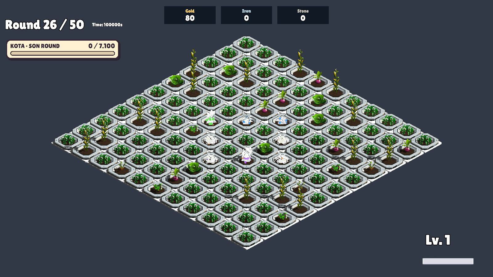
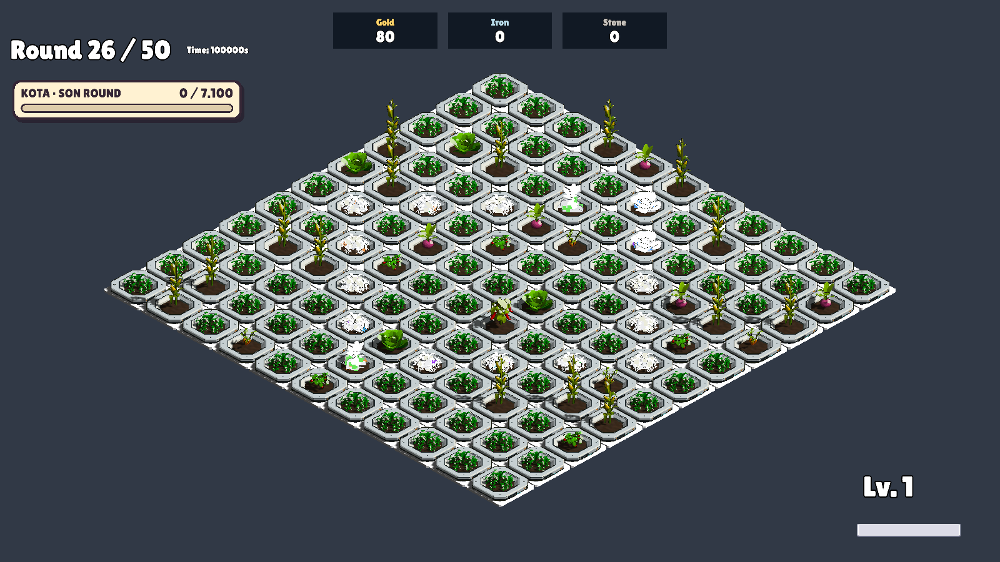

# Artçı Patlama: üç adımlı yayılma — 22 Ekim 2026

- [x] Kullanıcı mekanik/görsel sonucu onayladı: “artçı oldu tamamdır”.
- [ ] Sayısal dengeleme sonraya bırakıldı. Güçlü kart olarak konumlandırma; hasarı azaltma ve/veya oyuncuya artçı hasarını geliştirme imkânı verme değerlendirilecek. Henüz bir değer veya geliştirme sistemi seçilmedi.

Normal patlamanın vurduğu dört komşulu alan başlangıç sınırıdır. Artçı bu alanın dışına 0,2 saniye arayla üç kez, her adımda bir hücre ilerler. Saksı ayak izi ve ilk patlama alanı tekrar vurulmaz. Yayılma yalnız açık dört komşu hücrelerden geçer; kilitli hücrelerin üzerinden atlamaz. Bir dalgada aynı hücre tek kez işlenir. Ayrı ana patlamaların artçıları birbirinden bağımsızdır.

Her yeni hücrede küçük Battle_Effect_White efekti hasarla aynı adımda oynar. Canlı bitki gerçek PlantHealth.TakeDamage yolundan hasar alır ve normal darbe tepkisini verir. Hasar oranı ödülden okunur, katsayılar yeniden uygulanmaz. Artçı yeni artçı veya davranış zinciri başlatmaz. Kırmızı alan çizgisi ve hücre başına kamera sarsıntısı yoktur.

Bir ana patlama için tek kuyruk kaydı ve yeniden kullanılan dalga durumu tutulur. Hücre başına zamanlayıcı veya sahne araması yoktur. Round/run bitişi ve disable kalan işleri temizler. Duraklama süreyi durdurur; uzun karede üç adım tek kareye yığılmaz. Bu yüzden düşük FPS altında adımlar 0,2 saniyeden daha geç gelebilir.

Efekt havuzu başlangıç 4, üst sınır 128; dolunca yalnız görsel atlanır, hasar uygulanır. Dalga durumlarının boş önbelleği en fazla 128 kayıt tutar. Çok sayıda eşzamanlı dalganın hasarı bu sınırla düşürülmez. Isınma sonrasında koleksiyonlar ve efektler yeniden kullanılır. Eski echoRadius alanı kayıt uyumluluğu için durur, artçı geometrisini artık etkilemez. Mevcut asset ve lisans bilgisi Docs/ThirdParty-Licenses.md içinde; yeni üçüncü taraf içerik eklenmedi.

## Doğrulama

Unity 6000.3.14f1 ile izole GameScene üzerinde `AftershockWaveVerification.RunBatch`: PASS, süreç çıkışı 0. Gerçek zamanlayıcının Advance metodu deterministik sürelerle ilerletildi; gerçek hasar olayları ölçüldü. Bu test insan tarafından gerçek zamanlı oynanış/his onayı değildir.

- Merkezde ardışık 8, 12, 16 hedef: toplam 36 benzersiz hücre; erken darbe, tekrar veya dördüncü adım yok.
- 36 hücre efekti eşzamanlı kiralandığında atlanan efekt yok.
- Köşe, kilitli duvar ve çok hücreli saksı ayak izi doğrulandı.
- Duraklama, uzun kare, iptal ve disable temizliği doğrulandı.
- Isınma sonrası 100 dalgada yeni dalga durumu/efekt nesnesi oluşmadı; temizlik sonunda aktif iş ve kiralanmış efekt kalmadı. Tam bellek profiler incelemesi yapılmadı; bu sonuç mutlak memory-leak garantisi değildir.
- Üç adımın kamera görüntüleri kontrol edildi: beyaz küçük efektler dışarı doğru ilerliyor, kırmızı çizgi yok. Adımların ayrı görülebilmesi için ekran görüntüleri arasında önceki efektler temizlendi.

Test günlüğünde UnityEditor.Search.SearchDatabase başlangıç indekslemesine ait ArgumentOutOfRangeException var; yığın izinde oyun kodu yok. Kabul kontrolleri tamamlandı. Bu editör sorunu bu değişiklikte düzeltilmedi. Önceki aynı merkezli artçı/çizgi testleri yeni geometri için geçerli kabul ölçütü değildir.

[Test sonuçları](AftershockWaveVerification.txt)

