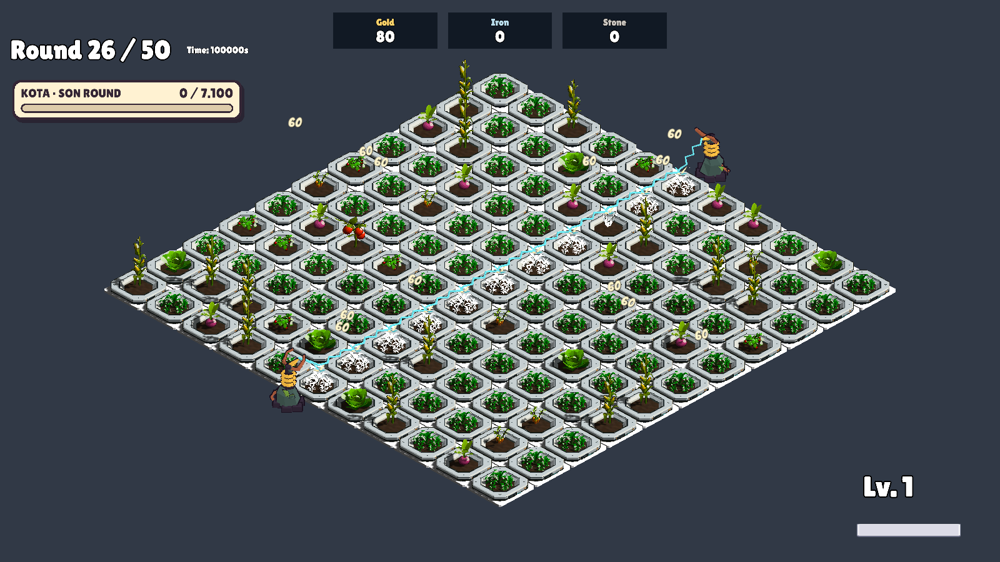
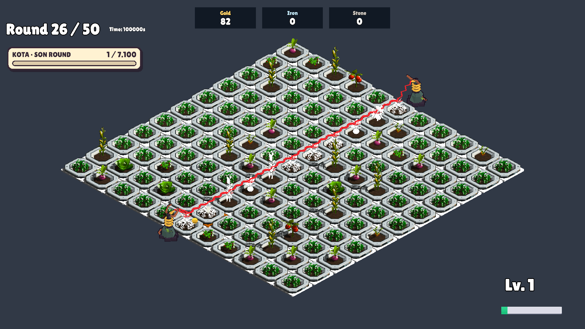
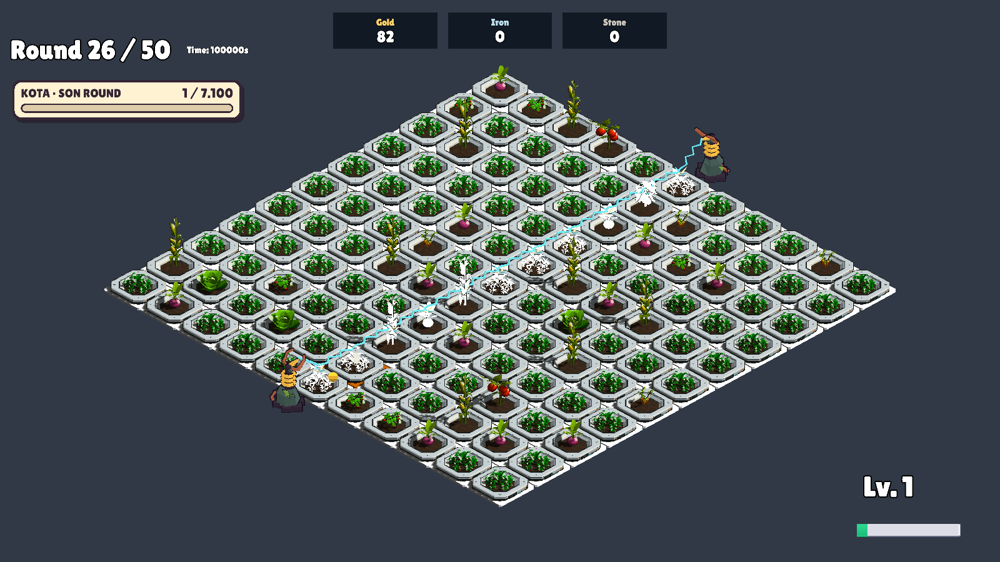

# Kapalı Devre — kırmızı ek darbe

22 Ekim 2026. CircuitDoubleMesh ve ContactDoubleMesh vertex renkleri kırmızı/açık kırmızıya çevrildi. Mevcut yüz gölgeleri korundu. Normal ConductiveFlashMesh dosyası değişmedi; kaynak ve test kopyasının SHA256 değeri aynı: 26070DF4172DA57D8850B0D384BA4AACEC92D54CA0E015E0201E8337B7DA44D5. AntennaArtBuilder üreticisi de aynı palete güncellendi.

Yeni üçüncü taraf varlık, materyal veya çalışma anında renk/material örneği eklenmedi. Projede özgün üretilmiş mevcut meshler düzenlendi. Hasar, şans, gecikme ve bekleme değerleri değiştirilmedi. Geri besleme işareti korunur; kırmızı renk gerçek ek vuruşta kullanılır.

Unity 6000.3.14f1, izole GameScene: AntennaArtBuilder.RecolorCircuitAndRunBatch, süreç çıkışı 0; AntennaArtVerification **52 PASS**.

- Gerçek normal hat hasadı bir ek vuruş planladı ve geri besleme işareti çıkardı.
- Planlanan etkinin gerçek OnTimer callback'i çağrıldığında bir ek hat darbesi çıktı; 10 canlı hedefte ayrı hasar olaylarıyla 27 hasar doğrulandı (normal 45 × 0,6).
- Aktif ek hat ve temas meshlerinin kırmızı renkleri kontrol edildi; ekran görüntüsü incelendi.
- Sonraki normal darbe cyan kaldı; normal/ek efektler arasında renk sızması yok.
- 30 ısınmış döngüde nesne, materyal ve mesh sayıları sabit; temizlikte aktif efekt kalmadı. Tam bellek profiler çalışması değildir.

Bu koşu zamanlayıcının 0,35 saniyesini ayrıca ölçmez; callback doğrudan çağrılır. İnsan görsel kabulü bekleniyor. İlk koşudaki renk testi linear vertex renklerini gamma renklerle karşılaştırdığı için başarısız oldu; renk uzayı ve yüz gölgelemesi dikkate alınarak düzeltildi, sonraki koşu geçti. Unity editörünün SearchDatabase başlangıç indeksleme istisnası günlükte mevcut; oyun koduna ait yığın izi yok, test tamamlandı.

[Test sonuçları](AntennaArtVerification.txt)

