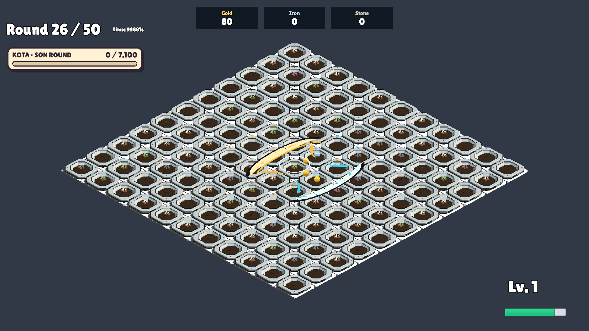

# Dolunay: bir ana hilal + bir büyük ek hilal

22 Ekim 2026 kullanıcı düzeltmesi: Bir tetikte toplam **iki** hilal bulunur: mevcut ana Hilal Darbesi ve yalnız bir büyük Dolunay hilali. Önceki iki ek dalga uygulaması yanlıştı; kaldırıldı.

Ek hilal baştan üç hücre genişliğinde doğar, sonradan büyümez; ana hilalden farklı rastgele geçerli ana yönde ilerler. Mouse halkası, yavaş hareket, Büyüyen Ay'ın 4 birim menzili, hasar oranı ve mevcut büyüme eşiği korunur. Ana hilaller için dört, ekler için dört olmak üzere toplam sekiz sınırlı dalga yuvası kullanılır. Ayrı tetikler aynı anda etkinse toplam sahne sayısı ikiyi aşabilir; bir tetiğin ürettiği sayı ikiyle sınırlıdır.

İzole GameScene / Unity 6000.3.14f1: MoonPolishVerification.RunBatch **101 PASS**, çıkış 0. Tek tetikte iki dalga, yalnız bir büyük ek, ek darbenin 56 hasarı ve sabit büyük boyutu, dört eşzamanlı ana hilale tam dört ek hilal, köşe yönü, gerçek saldırı akışı, havuz tekrarları ve temizlik doğrulandı. Ekran görüntüsü incelendi: bir cyan ana hilal ve bir altın ek hilal. Tam bellek profiler ölçümü değildir.

[Test sonuçları](MoonPolishVerification.txt)

