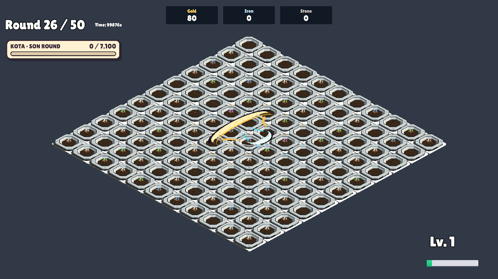

# Sürekli büyüme ve Dolunay — 23 Ekim 2026

İzole Unity doğrulaması: **213 PASS**, süreç çıkışı 0.

- Hız 4,5 birim/sn: temel 3 birim (~0,67 sn), Büyüyen Ay 4 birim (~0,89 sn).
- Ana hilal tüm hareketi boyunca katettiği mesafeyle doğrusal büyür; erken tam boyuta ulaşmaz. Hasada bağlı hasar artışı ayrı kalır.
- Dolunay her ana hilalle bir büyük ek hilal üretir. Eski iki ardışık hasat gereksinimi tam sürüm yolundan kaldırıldı. Ek hilal farklı yöndedir, sabit büyüklüktedir ve yeni hilal üretmez. Mevcut 0,15 sn gecikme, %70 taban hasarı ve saldırı duraklaması korunur.
- 50 hasatsız ana hilalin 50 ekstra üretmesi, 4+4 kapasitesi, son %10’da devam eden büyüme, geçersiz hücrelerden geçiş, hasar, havuz tekrar kullanımı ve tur temizliği doğrulandı.

[Otomatik kontrol raporu](MoonPolishVerification.txt). Tek ana + tek ek hilal ekran görüntüsü incelendi. Hareket hissi canlı kullanıcı değerlendirmesine açık.

