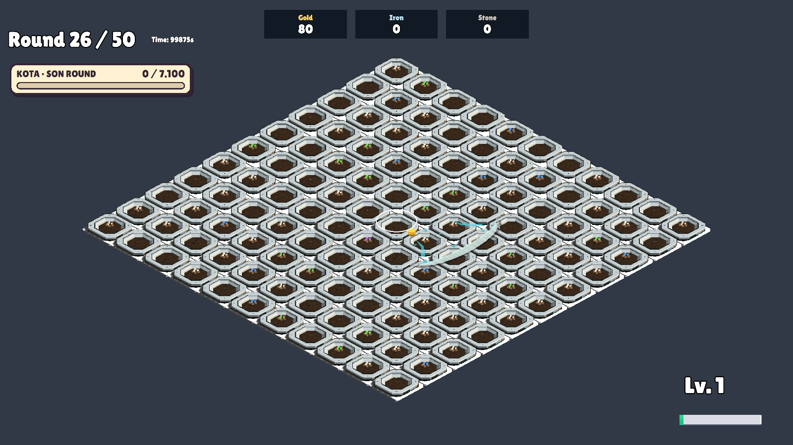

# Hilal yok oluş geçişi — 23 Ekim

Hız 10 birim/sn. Temel rota 0,30 sn; Büyüyen Ay rotası 0,40 sn.

Hilal son %35 mesafede hareket ederken smoothstep opaklık geçişiyle söner. Yol sonunda yerinde ezilerek küçülme kaldırıldı. Büyüme ve hasar rotası korunur; Dolunay da aynı geçişi kullanır. Görsel geçiş temel hilalde 0,105 sn, büyütülmüş menzilde 0,14 sn sürer.

Projede mevcut shader'a varsayılanı opak kalan isteğe bağlı opaklık/blend ayarları eklendi. Yalnız hilaller iki önbellekli saydam malzeme kullanır; renderer opaklığı MaterialPropertyBlock ile verilir. Malzemeler presenter yok olurken serbest bırakılır. Yeni üçüncü taraf içerik eklenmedi.

İzole Unity: 242 kontrol PASS. Renderer opaklığı, yol sonunda sıfır opaklık, 24 tekrar boyunca sınırlı malzeme önbelleği, 50 hasatsız Dolunay, hasar ve temizleme kontrolleri geçti. Solma anının ekran görüntüsü incelendi; canlı hareket hissi kullanıcı değerlendirmesine açık.

[Kontrol raporu](MoonPolishVerification.txt)

