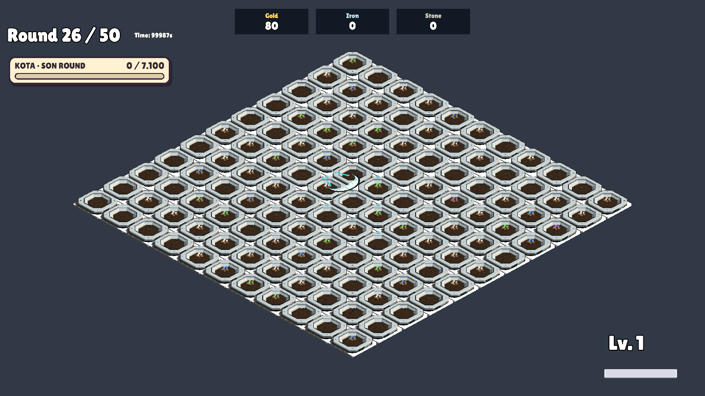
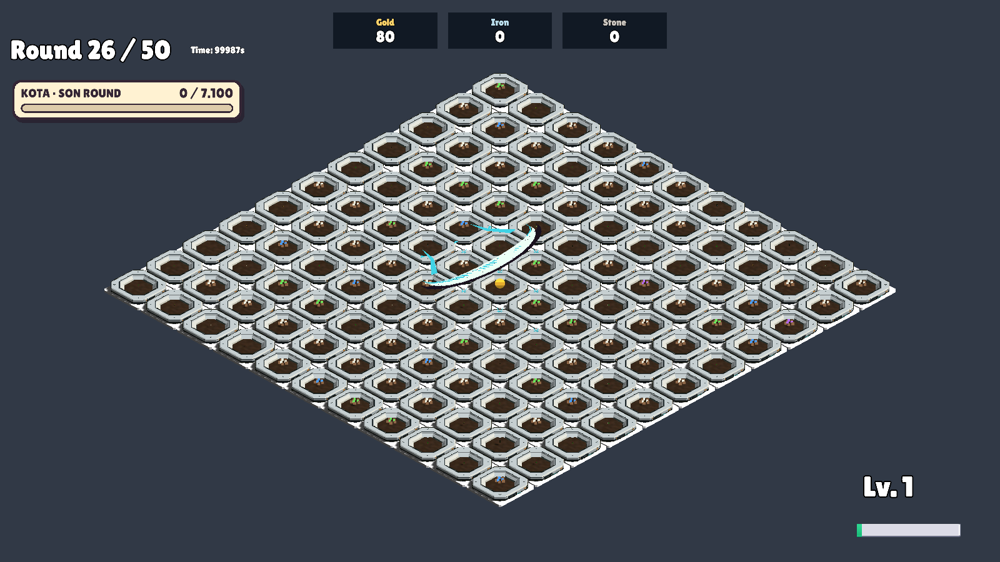
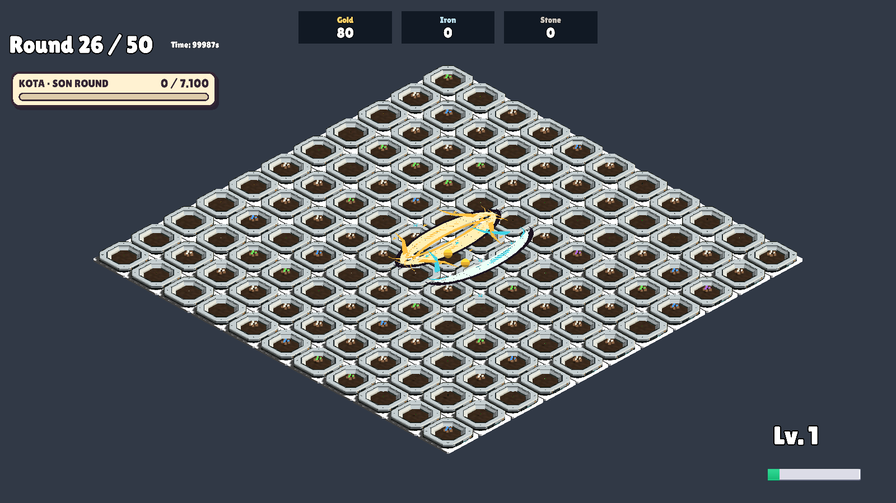

# Hilal Darbesi, Büyüyen Ay ve Dolunay — 22 Ekim 2026

Bu rapor önceki uygulamanın tarihsel kaydıdır. Kullanıcının sonraki hata bildirimiyle halka çıkışı, hız, büyüme ve Dolunay kapasitesi yeniden düzenlendi. Güncel durum: [MoonPolish-20261022](../MoonPolish-20261022/README.md).

Tam sürümün `Run50_GecOyunV1` profilindeki ortak fare rotası güncellendi. Eski karşılaştırma profillerinin `crescentFullRows=false` yolu bu yeniden tasarıma dahil değildir.

- Hilal doğrudan saldırının dünya konumundan dört ana yönden rastgele birine çıkar. Doğum noktasından çizgisel ilerler; hücre merkezine çapraz kaymaz. Menzil en fazla 3 dünya birimidir, açık alan kenarında kısalır. Bu değer üç hücre değildir: mevcut 2 birimlik gridde merkezden başlayan temel rota başlangıç ve sonraki hücreye vurur, kalan 1 birimde görsel ilerleyişini bitirir.
- Hücre adımı 0,07 saniyeden 0,3 saniyeye çıkarıldı. İlk darbe doğum noktasında 0,3 saniye sonra, sonraki darbe bir adım sonra gelir. Görsel ve hasar aynı oyun saatini kullanır. Temel hilal geri dönmez.
- Büyüyen Ay'ın mevcut kuralı korunur: gerçek hasat sonraki cephenin genişliğini/hasarını artırır, hasatsız adım büyümeyi sıfırlar. Büyüme dalgalar arasında taşınmaz.
- Dolunay mevcut büyüme eşiğinde artık karşı uçtan dönmez; ilk saldırının saklanan mouse noktasından iki ek hilal çıkar. İlk yön dört seçenekten, ikinci yön kalan üç seçenekten seçilir. Aynı yön mümkün değildir; dik ve zıt çiftler mümkündür. Sonradan hareket ettirilen mouse'u takip etmezler.
- Dolunay eşiği, her dalganın hasar oranı, ilk darbe gecikmesi ve saldırı duraklaması korundu. İki ek dalga büyümez, yeniden Dolunay tetiklemez. Ayrı dalgalar kesişen hedeflere ayrı hasar verebilir; toplam denge bu çalışma ile onaylanmış sayılmaz.
- Mevcut dört aktif dalga sınırı ve görsel havuzu korunur. Çift için iki boş dalga yeri ve yeterli zamanlayıcı kapasitesi yoksa çift bütünüyle atlanır; tek başına bir yarım çift çıkarılmaz. Dalga bitişinde, round bitişinde ve run temizliğinde kayıtlar bırakılır.

Yeni asset, paket veya üçüncü taraf içerik eklenmedi. Mevcut modeller, shaderlar ve havuz kullanıldı. Kart açıklamaları ve üretici güncellendi. Manuel ay testinde 100 taban hasara karşı 150 can kullanılır: doğrudan vuruşun ±%15 sapması bitkiyi öldürmez, ardından hilal hasat edip büyümeyi ve Dolunay'ı gösterebilir.

## Doğrulama yöntemi

Son koşu: **109 PASS**, Unity süreç çıkışı 0. Gerçek doğrudan saldırı → hilal → büyüme → iki Dolunay dalgası zinciri de geçti.

İzole gerçek GameScene, Unity 6000.3.14f1; `MoonCursorVerification.RunBatch`. Rota/büyüme kontrolleri gerçek dalga callback'lerini deterministik çağırır. Ayrı son kontrol gerçek RunEffects.Update zamanlayıcısını kullanır; 0,3 ve 0,6 saniyelik hasar anlarını ve kalan görsel hareketinin tamamlanmasını denetler.

Kontroller: doğrudan isabetle şarj, boş/engellenen vuruşlar, dört yön, 3 birim sınırı, düz rota, ödül RNG'sinin korunması, 80 temel/100 büyümüş/56 Dolunay hasarı, büyüme ve sıfırlanma, 40 tetikte farklı yön çiftleri ve altı olası yön çiftinin görülmesi, küçük grid, grid büyümesinde rota sabitliği, duraklama, round/run temizliği. Görüntüler mekanik adımlarda alınmıştır; insan tarafından gerçek zamanlı hız/his kabulü değildir. Tam bellek profiler çalışması yapılmadı.

Önceki tüm alanı tarama/karşı uçtan dönüş bekleyen ay testleri yeni tasarımın kabul ölçütü değildir. İlk genişletilmiş koşuda önceki sıfır hasar testinden kalan stat temizlendi; uçtan uca senaryoda doğrudan hasar sapması dikkate alınarak bitki canı düzeltildi. Unity SearchDatabase başlangıç indeksleme istisnası günlükte ayrıca bulunur; oyun koduna ait yığın izi değildir.

[Son test sonuçları](MoonCursorVerification.txt)

