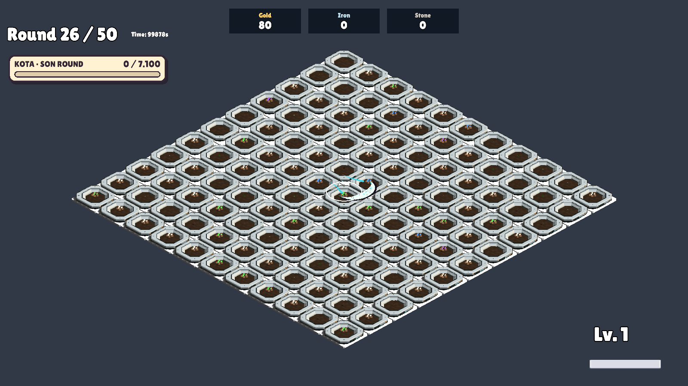
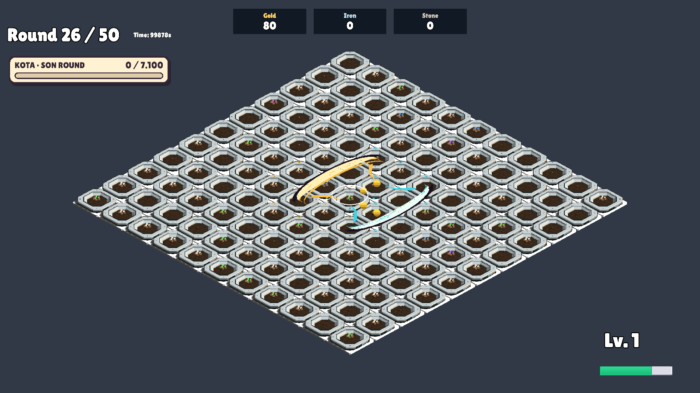

# Hilal yüksekliği ve hız ayarı — 22 Ekim 2026

Kullanıcının saksıya gömülme ekran görüntüsü üzerine ana hilal ve Dolunay'ın ortak sunum yüksekliği +0,12'den +0,65 dünya birimine çıkarıldı. Hareket hızı 2,5 → 3,2 birim/sn (+%28). Temel 3 birim yaklaşık 0,94 saniye, Büyüyen Ay'ın 4 birimi yaklaşık 1,25 saniye sürer. Hasar yeni hareket hızının varış zamanlarıyla eşzamanlıdır. Menzil, hasar oranları ve bir ana + bir büyük Dolunay sayısı değişmedi.

İzole Unity GameScene: MoonPolishVerification.RunBatch **101 PASS**, çıkış 0. Yeni süreler, hasar, Dolunay sayısı, büyüme ve havuz kontrolleri geçti. Halka ve Dolunay görüntüleri incelendi; yeni yükseklikte bıçak gövdeleri saksı üstünde görünür. Gerçek oyun hissi için kullanıcı kabulü bekleniyor.

[Test sonuçları](MoonPolishVerification.txt)

