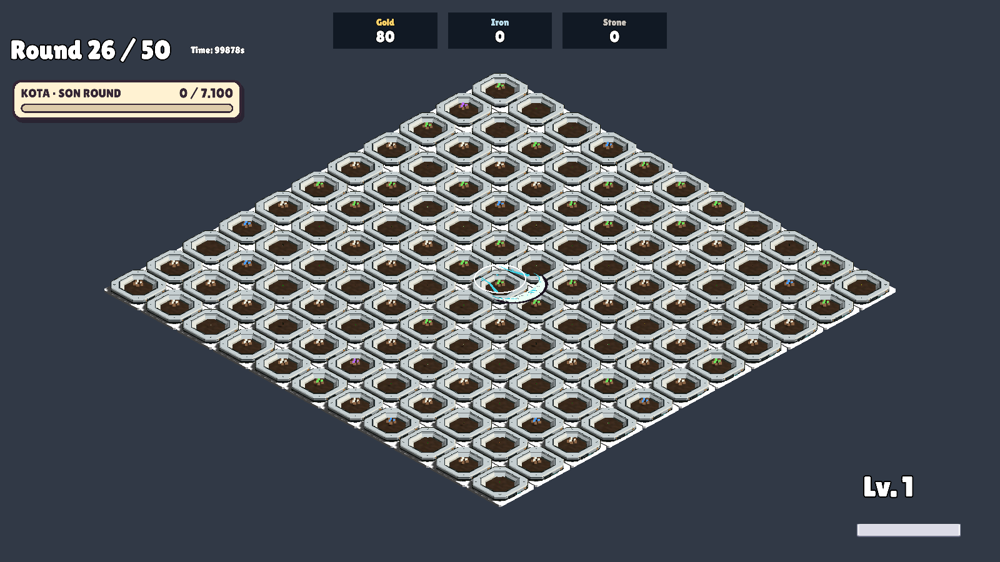
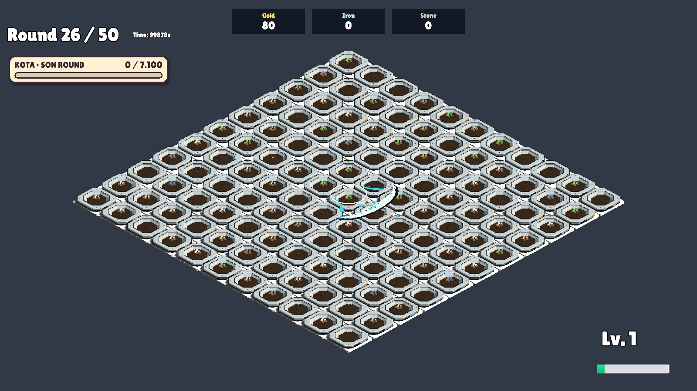
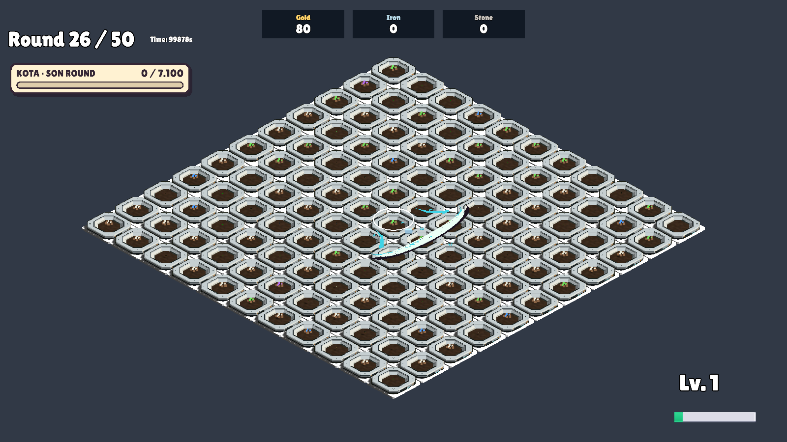
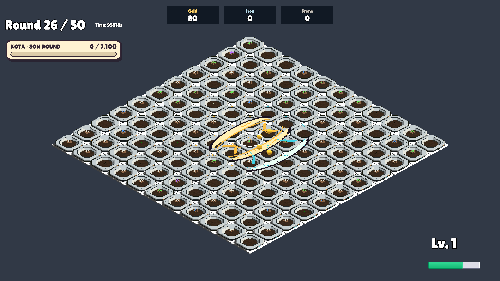

# Ay ailesi: halka çıkışı, okunurluk ve Dolunay düzeltmesi

**Sonraki kullanıcı düzeltmesi:** Dolunay iki ek dalga değil, yalnız bir büyük ek hilal üretir: ana hilal dahil toplam iki. Güncel sayı, kapasite ve doğrulama için [tek ek hilal raporu](../FullMoonSingle-20261022/README.md). Aşağıdaki çift/12 yuva bilgileri önceki uygulamanın tarihsel kaydıdır.

22 Ekim 2026. Önceki MoonFamily-20261022 çalışmasının ardından kullanıcı hızlı hareket, kayık doğum noktası, ani büyüme ve Dolunay'ın görünmemesini bildirdi. Bu rapor güncel uygulamayı kaydeder.

- Hilalin gövdesi gerçek saldırının mouse halkası yarıçapında başlar; kesici yüzü dışarı bakar. Saldırı anındaki merkez ve yarıçap saklanır. Sonradan mouse hareketi dalgayı sürüklemez. Yükseklik halkaya yaklaştırıldı.
- Tam sürüm hareketi artık hücre başına sabit bekleme yerine dünya mesafesi/hızına dayanır: 2,5 birim/sn. Temel dalga çıkıştaki kesici yüzünden itibaren 3 birim (yaklaşık 1,2 sn), Büyüyen Ay ile 4 birim (yaklaşık 1,6 sn) yol alır. Tarla kenarı rotayı kısaltabilir. Hasar, kesici yüz ilgili hücre hizasına ulaştığında uygulanır.
- Temel modelin boyu 1,6'dan sabit 2'ye, başlangıç görsel genişliği 2'den 2,4'e çıktı. Doğuşta ezilmiş ölçekten açılma kaldırıldı. Hasatla büyürken uzunluk/pivot değişmez: önceki geriye sıçrama nedeni kaldırıldı. Genişleme ve sıfırlanmadaki küçülme 0,3 saniyelik yumuşak geçişle olur; sonraki hasar cephesiyle eşleşir.
- Dolunay için toplam dört yuvanın tümünü ana hilallerin doldurması sorunu giderildi: en çok dört ana hilal ve sekiz ek dalga, toplam on iki sınırlı yuva. Köşede tarla dışına giden yönler elenir; iki geçerli farklı yön arasından seçim yapılır. En az iki geçerli yön yoksa veya genel zamanlayıcı kapasitesi doluysa çift üretilemeyebilir. Hasat/büyüme eşiği hâlâ gereklidir; ödül her saldırıda koşulsuz çalışmaz.
- Tam sürümün hareketi CrescentEffect.Cursor.cs içinde ayrıldı. Eski karşılaştırma profilinin hareket yolu korunur. Mevcut görsel havuzu kullanılır; yeni üçüncü taraf içerik veya runtime materyal örnekleme eklenmedi.
- Manuel ay senaryosunda ilk saldırının alanındaki bitkiler 150 can, dış hedefler 1 can: doğrudan saldırı şarj sağlar, dışarı çıkan hilal hasat yapıp Dolunay'ı gösterebilir. Bu test düzeni gerçek oyun dengelemesi değildir.

## Doğrulama

İzole GameScene, Unity 6000.3.14f1, MoonPolishVerification.RunBatch: **99 PASS**, süreç çıkışı 0. Önceki 41 PASS koşusundan sonra eklenen kontroller de tamamlandı. Kullanım limiti yüzünden önceki çalıştırılamayan test bu devamda çalıştırıldı.

- Gerçek halka yarıçapında doğum, 3/4 birim mesafe ve 1,2/1,6 saniye hareket süresi.
- Ani genişleme/küçülme olmaması, geçişin ortası/sonu ve kesici yüzün geriye gitmemesi.
- Dört ana hilal eşzamanlıyken dört Dolunay çiftinin oluşması ve on iki görselin havuzdan gösterilmesi.
- Gerçek doğrudan saldırı → dışarı çıkan hilal → hasat/büyüme → Dolunay akışı.
- Köşede farklı iki iç yön; ek dalgaların yeniden Dolunay üretmemesi.
- Dört ısınma + yirmi ölçüm tekrarında sunum nesnesi sayısının sabitliği; round sonunda dalga, görsel ve zamanlayıcı temizliği.
- Gerçek RunEffects.Update zamanlayıcısıyla yavaş rotanın bitmesi ve iki hedefte beklenen 80 hasar.

Halka, temel hilal, büyüme ara/son hali ve Dolunay görüntüleri incelendi. Bu kontrol insanın gerçek zamanlı hız/his kabulünün yerine geçmez. Tam bellek profiler incelemesi yapılmadı. UnityEditor.Search.SearchDatabase başlangıç indekslemesinde ayrı bir ArgumentOutOfRangeException günlükte mevcut; test kontrolleri tamamlandı.

[Kontrol sonuçları](MoonPolishVerification.txt)

