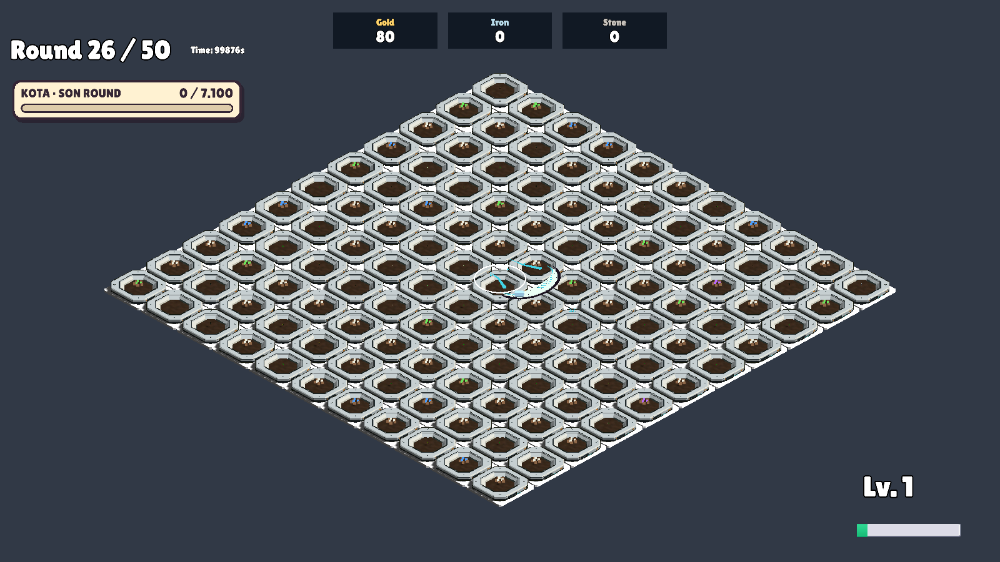
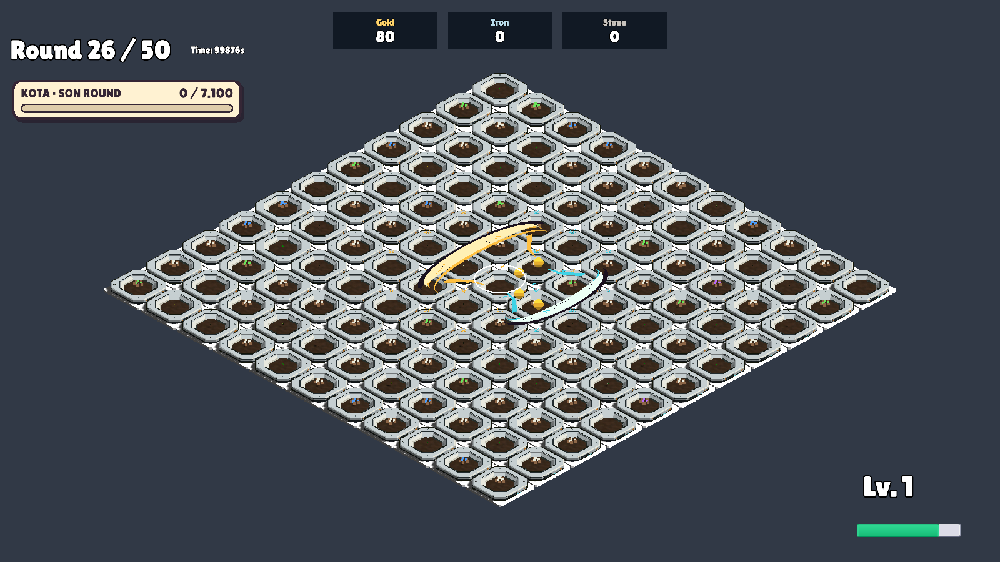

# Ay hareketi ve büyümesi

22 Ekim 2026: İzole Unity batch koşusu, **108 PASS**, çıkış kodu 0.

Hız 3,8 dünya birimi/sn. Temel rota 3 birim (~0,79 sn); Büyüyen Ay 4 birim (~1,05 sn). Tarla sınırı ve kilitli hücreler hareketi kesmez; hasar yalnız açık, geçerli hücrelere uygulanır. Görsel genişlik tarla sınırında kırpılmaz.

Ana hilal doğuştan itibaren katettiği mesafeye bağlı büyür; rotanın %80’inde tam genişliğe ulaşır (~0,84 sn). Hasada bağlı hasar büyümesi değişmedi. Dolunay tek büyük ek hilaldir, farklı yönde çıkar ve boyutu sabit kalır.

[Kontrol sonuçları](MoonPolishVerification.txt). Erken büyüme ve tek Dolunay görüntüleri incelendi; iki hilal ve boyut farkı görünür. Köşe/kilitli hücre geçişi otomatik konum/hasar kontrolleriyle doğrulandı; kenarda canlı oynanış videosu incelenmedi.

